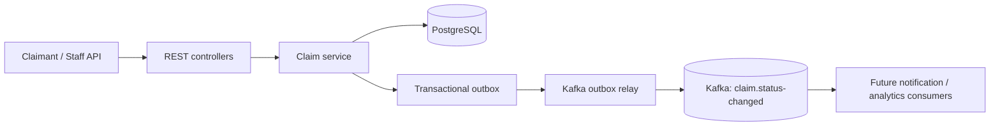

# Chubb APAC Claims Backend

A single Spring Boot application for a claims workflow across multiple APAC markets. The current
vertical slice supports claim intake, token-protected claimant tracking and information responses,
staff work queues, assignment, review, information requests, and decisions. The frontend is out of
scope. Authentication/authorization and integrations with policy, document storage, payments, and
notifications are not implemented yet.

## Architecture

Feature packages own their API, service, domain, and repository layers. Controllers validate and
map HTTP requests; services enforce workflow rules and own database transactions; repositories
persist domain data. Flyway is the only schema owner (`ddl-auto: none`).



The claim and its outbox event are committed in the same PostgreSQL transaction. A scheduled relay
publishes pending events and marks them sent only after Kafka acknowledges them. This is **at-least
once** delivery: consumers should deduplicate using `eventId`, because a process crash after Kafka
acknowledgement but before the database update can cause a repeat. Kafka messages are keyed by claim
number to preserve per-claim partition ordering. Claimants get a randomly generated tracking token
once at submission; only its SHA-256 hash is stored.

The implemented lifecycle is `SUBMITTED → UNDER_REVIEW`; review can request information
(`AWAITING_INFORMATION`) and resume after the claimant replies, then record `APPROVED` or
`REJECTED`. An approved claim can be marked `SETTLED` when staff records a confirmed payment.

### PostgreSQL model

`src/main/resources/db/migration/V1__claims_workflow.sql` creates:

| Table | Responsibility |
|---|---|
| `claimants` | Contact identity reused by email; personal contact data is kept outside claim events. |
| `claims` | Current claim, market/product, policy reference, incident, exposure estimate, status and assignment. |
| `claim_assignments` | Append-only assignment history with one active assignment per claim. |
| `claim_status_history` | Audit trail of each status transition and its actor/reason. |
| `claim_documents` | Document metadata and storage key; file bytes belong in object storage, not PostgreSQL. |
| `claim_information_requests`, `claim_information_responses` | Requests for evidence and claimant replies. |
| `claim_decisions` | Approved/rejected outcome, rationale and assessed liability. |
| `claim_settlements` | One recorded settlement/payment reference and amount for each settled claim. |
| `outbox_events` | Durable event records committed atomically with claim changes. |

Indexes support the market/status work queue, assignee queue, claim timelines and pending outbox
relay. Amounts use `NUMERIC(15,2)` with an explicit ISO currency code; market codes are stored per
claim rather than hardcoding a presumed list of six jurisdictions. Configure/validate the approved
market list and local currency rules against Chubb's business requirements before production.

### Kafka

The current topic is `claim.status-changed`. It carries versionable JSON event records for
submission, assignment, information requests/responses, decisions, and settlements; `eventType`
differentiates them. Keep personally identifiable contact information and document contents out of Kafka. The
single-broker Docker setup uses one replica and is for development only; production should use
replication, ACLs/TLS, schema compatibility controls, alerting, and a dead-letter/replay strategy.

## API outline

| Endpoint | Use |
|---|---|
| `POST /api/v1/claims` | Submit motor/property claim. Returns claim number and tracking token once. |
| `GET /api/v1/claims/{claimNumber}` | Track status/history and view requested information. Requires `X-Claim-Tracking-Token`. |
| `POST /api/v1/claims/{claimNumber}/information-requests/{requestId}/responses` | Respond to a request; requires the tracking token. |
| `GET /api/v1/staff/claims` | Paginated queue; optional `status`, `marketCode`, and `assignedTo` filters. |
| `POST /api/v1/staff/claims/{claimNumber}/assignment` | Assign or reassign a claim. |
| `PATCH /api/v1/staff/claims/{claimNumber}/status` | Start/resume review. |
| `POST /api/v1/staff/claims/{claimNumber}/information-requests` | Ask the claimant for information. |
| `POST /api/v1/staff/claims/{claimNumber}/decision` | Record an approval or rejection. |
| `POST /api/v1/staff/claims/{claimNumber}/settlements` | Record a confirmed settlement for an approved claim. |
| `GET /api/v1/staff/claims/workload` | Current market/product/currency/status/assignee workload and exposure aggregates. |

Swagger UI is at `http://localhost:8080/swagger-ui.html`. Staff routes currently have no
authentication; do not expose this service publicly until identity, role-based access, audit actor
trust, rate limiting, and market-level authorization have been implemented.

## Start the application

Use the detailed [startup checklist](STARTUP.md). The quick path with Docker is:

```bash
docker compose up --build
```

If host port `9092` is already in use, start Compose with another port, for example
`KAFKA_EXTERNAL_PORT=19092 docker compose up --build`. This changes the port for Kafka clients
running on your machine; the app and Kafka UI inside Docker continue to use `kafka:19092`.

Health: `http://localhost:8080/actuator/health` · Swagger:
`http://localhost:8080/swagger-ui.html` · Kafka UI: `http://localhost:8090`.

To exercise the API, import [`postman/insurance-app.postman_collection.json`](postman/insurance-app.postman_collection.json)
into Postman and run the **Approved claim - full workflow** folder in order. The collection saves
claim numbers, tracking tokens, and information request IDs from responses. It also includes an
optional rejection workflow.

To submit a claim, use Swagger or send the JSON request described in `STARTUP.md`. Preserve the
returned tracking token; it cannot be retrieved later.

## Configuration

| Variable | Default | Description |
|---|---|---|
| `DB_URL` | `jdbc:postgresql://localhost:5432/insurancedb` | Default when running the app on your machine |
| `DB_USER`, `DB_PASSWORD` | `postgres` / `postgres` | Local PostgreSQL credentials; override for your environment |
| `KAFKA_BOOTSTRAP_SERVERS` | `localhost:9092` | Kafka broker address |
| `KAFKA_EXTERNAL_PORT` | `9092` | Host port exposed by Compose for Kafka clients outside Docker |
| `KAFKA_GROUP_ID` | `insurance-app` | Consumer group for future listeners |
| `OUTBOX_POLL_INTERVAL_MS` | `1000` | Pending-event polling interval |
| `POSTGRES_USER`, `POSTGRES_PASSWORD` | `postgres` / `postgres` | Compose PostgreSQL credentials |

Copy `.env.example` to `.env` to override Docker Compose values. Both Docker Compose and a host-run
application default to the `insurancedb` database with `postgres` / `postgres` credentials. Don't
use these development credentials outside local development; use environment variables rather than
committing private credentials.

## Project layout

```text
src/main/java/com/insurance/
  claims/{api,domain,repository,service}/  claim workflow layers
  common/                                  REST exception mapping
  config/                                  Kafka and OpenAPI configuration
  events/                                  event contracts and topic names
  messaging/                               transactional outbox and Kafka relay
src/main/resources/
  application.yml
  db/migration/                            versioned PostgreSQL schema
```

## Development status

This is an initial implementation, not a production-ready claims system. Unit tests cover the claims
API routes, request validation, service workflow rules, and repository/outbox interactions. Before
release, add database-backed integration and concurrency tests; authentication/authorization;
idempotency for submission and claimant responses; market and policy eligibility validation; secure
document upload and malware scanning; payment integration; staff performance aggregates; event
schema versioning and multi-instance outbox claiming; retention/consent controls; and production
Kafka/PostgreSQL deployment configuration.
